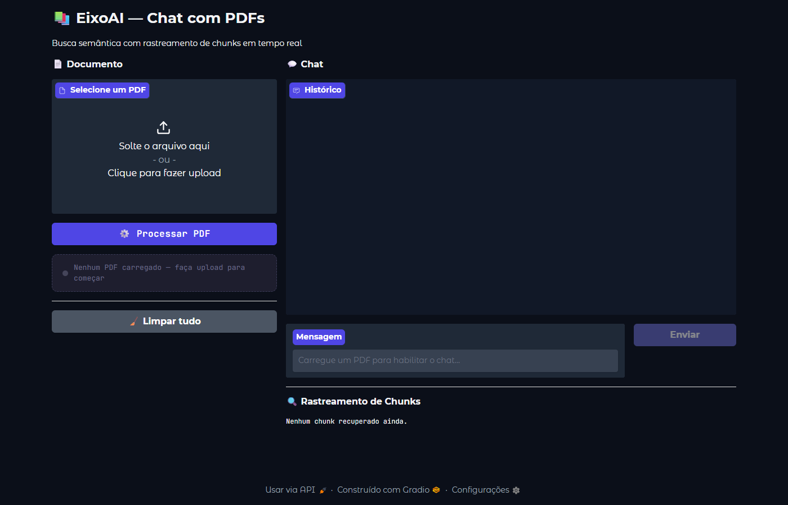
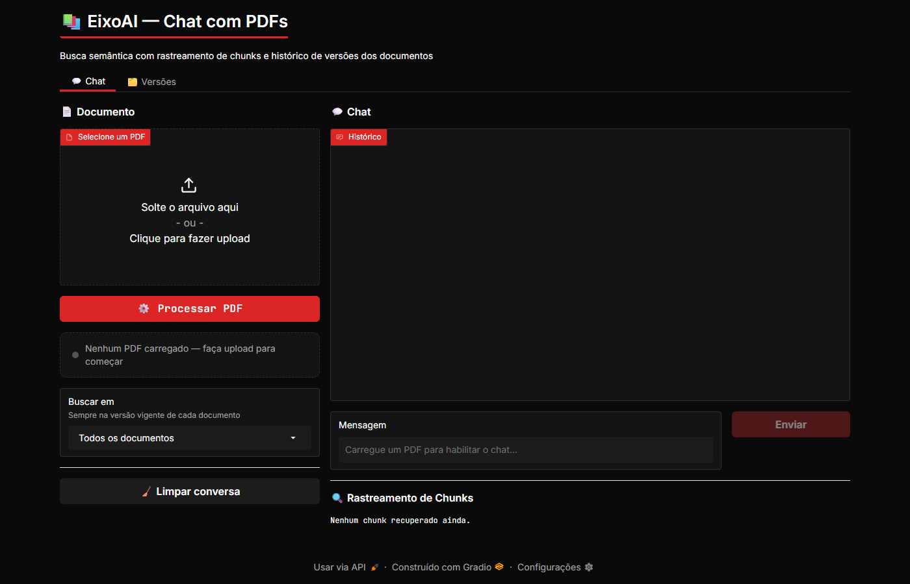
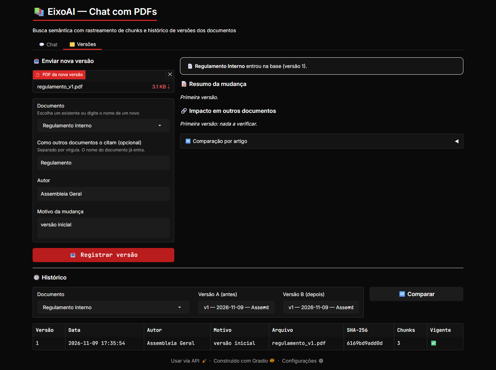
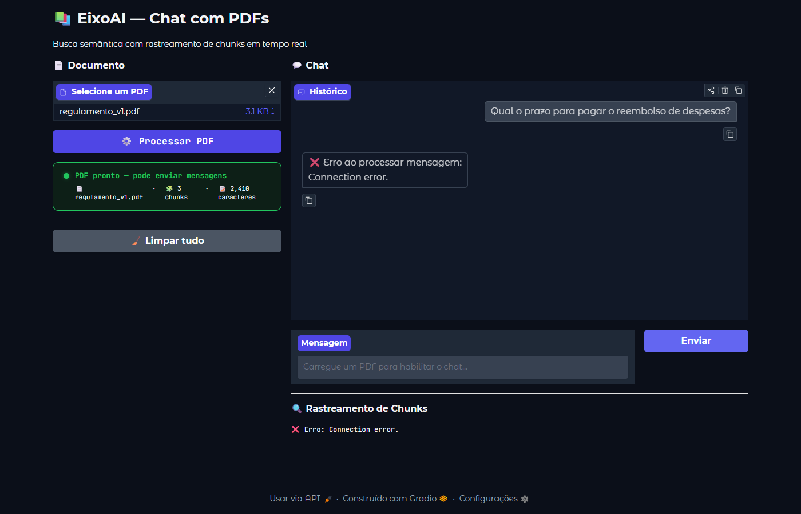
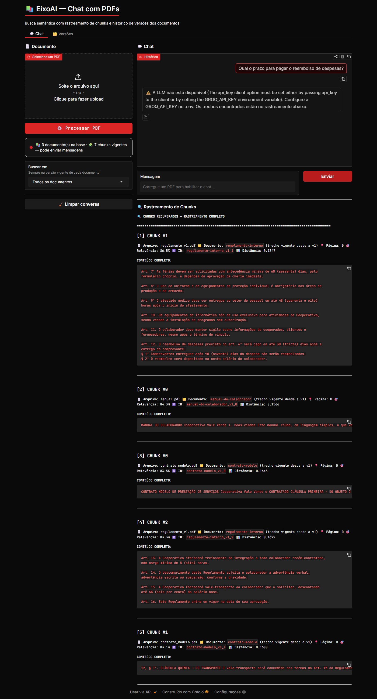
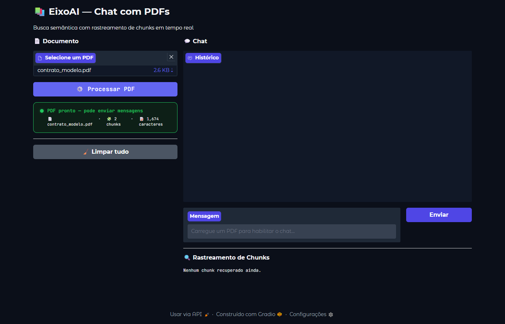
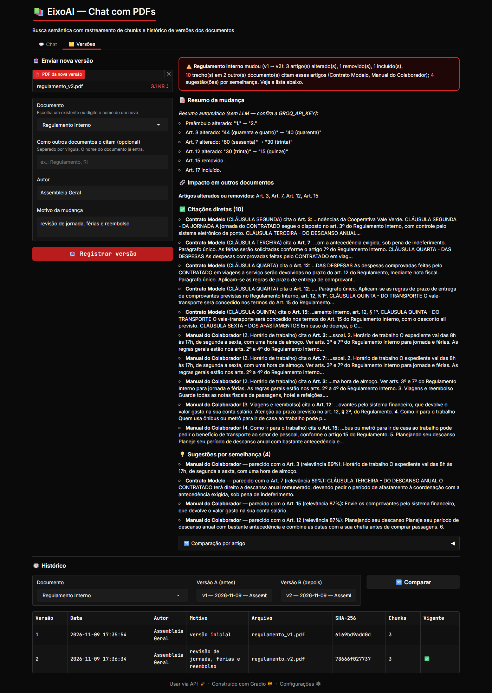

# Antes e depois

As mudanças da Atividade 04, comparadas com o código original (commit `36f10ca`).
As capturas foram tiradas com os dois códigos rodando lado a lado, com os mesmos PDFs de `data/exemplos/pdf/` e **sem chave do Groq** nos dois. Por isso a LLM não responde em nenhum deles; o que muda é o que cada um faz sem ela.

## Na tela

### 1. Tela inicial

| Antes | Depois |
|---|---|
|  |  |
| Uma tela só, tema azul e verde. | Duas abas, "Chat" e "Versões", na paleta vermelha, preta e branca. |

### 2. Primeiro documento

| Antes | Depois |
|---|---|
|  |  |
| Upload pelo chat, sem registro de quem enviou nem por quê. | Na aba Versões: documento, apelidos, autor e motivo. O histórico mostra data e SHA-256. |

### 3. Uma pergunta ao chat

| Antes | Depois |
|---|---|
|  |  |
| Sem LLM, o erro apaga até o rastreamento dos trechos. | A busca roda mesmo sem LLM: a resposta explica o que falta configurar e os trechos encontrados aparecem, nos 3 documentos da base. |

### 4. Segundo upload

| Antes | Depois |
|---|---|
|  |  |
| O contrato **substitui** o regulamento: `clear_all()` apaga a base inteira. | A v2 do Regulamento entra como versão nova, e a faixa vermelha avisa na hora: 3 artigos alterados, 1 removido e 1 incluído; 10 trechos em 2 documentos citam esses artigos; 4 sugestões por semelhança. |

### Telas novas, sem equivalente no original

- [Comparação por artigo aberta](img/depois_05_comparacao.png): diff de cada artigo alterado.
- [A mesma pergunta depois da v2](img/depois_06_pergunta_v2.png): o trecho vem da v2 ("15 (quinze) dias"); o texto antigo (30 dias) não aparece mais.
- [Campo "Buscar em"](img/depois_07_buscar_em.png): todos os documentos ou um só.

## No código

### 1. Subir um PDF apagava a base inteira

**Antes** (`src/app.py`, `process_pdf`):

```python
# Limpa TODO o banco antes de inserir — garante que nunca existam
# chunks de sessões anteriores ou de uploads anteriores na mesma sessão.
retriever.clear_all()
current_document_id = new_doc_id
result = retriever.add_document(document_id=current_document_id, text=text, source=file_name)
```

**Depois:** o upload registra uma versão e não apaga nada.

```python
res = publish_version(
    store, get_retriever(), name=display, text=text, filename=filename,
    sha256=sha256_file(file_path), author=author, reason=reason, aliases=[display] + alias_list,
)
```

| | Antes | Depois |
|---|---|---|
| Documentos na base | 1 | quantos quiser |
| Versão anterior | apagada | guardada (texto no SQLite, chunks que mudaram marcados como não vigentes) |
| Mesmo arquivo de novo | reindexa | detecta pelo SHA-256 e não cria versão |
| Quem mudou, quando, por quê | não existe | autor, data, motivo e SHA-256 |

### 2. Estado global compartilhado entre usuários

**Antes:** `current_document_id`, `chat_history` e `llm_chain` eram variáveis globais. Dois usuários no mesmo link (`share=True`) dividiam o histórico do chat.

**Depois:** o `LLMChain` de cada sessão fica em `gr.State`. O que é compartilhado de propósito (modelo, ChromaDB, registro de versões) continua global, com trava nas operações que não podem rodar em paralelo.

### 3. A busca só vê a versão vigente, e versões não duplicam chunks

**Antes** (`src/retriever.py`): `search(query, top_k, rerank)` procurava na coleção inteira.

**Depois:** cada chunk tem `is_current`, `version` (a versão em que apareceu) e `version_to` (a versão em que saiu), e a busca filtra pelos vigentes:

```python
def search(self, query, top_k=5, rerank=True, only_current=True,
           document_id=None, exclude_document_id=None, passage=False)
```

Uma versão nova não reindexa o documento inteiro (`add_version`):

- chunk igual ao da versão anterior: fica onde está;
- chunk que mudou: é aposentado (`is_current=False`);
- chunk novo: entra.

Na v2 do Regulamento, isso mexe em poucos chunks em vez de recriar todos.

### 4. Chunker e documentos que só citam artigos

**Antes:**

```python
has_articles = bool(re.search(r"\bArt\.\s*\d+", text, re.IGNORECASE))
```

Um manual que dizia "conforme o art. 12 do Regulamento" era tratado como lei e virava chunks enormes.

**Depois:**

```python
ARTICLE_START = re.compile(r"(?m)^[ \t]*Art\.\s*\d+")
if not has_article_structure(text):   # vai para o chunker semântico
```

Para a CF/88 o resultado é o mesmo: os artigos dela começam a linha.

### 5. Avaliação

**Antes:** `RAGEvaluator` buscava na coleção inteira, o que funcionava porque a base só tinha um documento.
**Depois:** a busca da avaliação fica restrita ao documento avaliado (`document_id=doc_id`).

### 6. Interface

| | Antes | Depois |
|---|---|---|
| Paleta | tema `Soft` (azul, verde, amarelo) | vermelho, preto e branco (`THEME` em `app.py`) |
| Botão do chat | "Limpar tudo" apagava o documento do banco | "Limpar conversa" limpa só o chat |
| Sem chave do Groq | erro, sem trechos | busca roda e mostra os trechos |
| Texto do PDF na tela | Markdown cru | escapado (um PDF não injeta imagem nem link) |
| Primeiro upload | esperava o modelo carregar (9–15 s) | o modelo carrega em segundo plano quando o app sobe |

## Números

| | Antes | Depois |
|---|---|---|
| Hit Rate CF/88 (48 perguntas) | 83,3% | 83,3% (igual pergunta a pergunta) |
| MRR / NDCG | 68,9% / 70,6% | 68,9% / 70,6% |
| Buscas por pergunta no chat | 2 (`search` + `get_context`) | 1 |
| Publicar uma revisão de 3 artigos da CF/88 | — | 1,1 s (era 11,5 s na 1ª versão da melhoria) |
| Análise de impacto nessa revisão | — | 2,6 s (era 5,7 s) |
| Artigos alterados detectados | — | 5/5 |
| Citações diretas encontradas | — | 10/10, nenhuma falsa |
| Precisão das sugestões | — | 4/4 (na primeira tentativa, só com limiar: 5/10) |
| Testes | 4 suítes | 6 suítes; as 2 novas com 37/37 |

Detalhes e ressalvas em [`VERSIONAMENTO.md`](VERSIONAMENTO.md).
