# Atividade 04 — Manutenção em projeto existente: EixoAI

Equipe: Luiz Alberto Rezende Costa, João Gabriel Nascimento Rodrigues
Disciplina de Agentes, Prof. Andrei Formiga
Código (fork com as alterações): <https://github.com/Jgabriel7z/Atividade-04-andrei> · Projeto original: <https://github.com/kaio-w-b/EixoAi>

## 0. O projeto original, antes da manutenção

O [EixoAI](https://github.com/kaio-w-b/EixoAi) é um projeto de um autor só, o Kaio Wellinghton, com licença MIT. Tem 14 commits, feitos entre 2026-01-14 e 2026-04-07. Já era um RAG completo de ponta a ponta, mas pensado para **uma pessoa e um PDF por vez**.

**Tamanho do código** (commit `36f10ca`, o último do autor):

| Parte | Arquivos | Linhas de Python | O que faz |
|---|---|---|---|
| Interface (`app.py`) | 1 | 458 | Tela única do Gradio: envio de um PDF, botão de processar, chat e botão de limpar. O estado fica em variáveis globais (documento atual, retriever), então só serve a uma pessoa |
| Leitura do PDF (`ingester.py`) | 1 | 89 | Extrai o texto com o pypdf |
| Busca (`retriever.py`) | 1 | 450 | Quatro formas de dividir o texto: por artigo (texto jurídico), semântica, tamanho fixo e por frase. Gera os embeddings com o multilingual-e5-small (prefixos `passage:` e `query:`), guarda no ChromaDB persistente e busca o dobro de candidatos para reordenar |
| LLM (`llm_chain.py`) | 1 | 178 | LangChain + Groq (llama-3.3-70b), com histórico da conversa e reescrita da pergunta pela LLM |
| Avaliação (`eval/`) | 3 | 1.332 | 48 perguntas da CF/88 com gabarito (palavras-chave, resposta, artigo e dificuldade). Mede Hit Rate, MRR, NDCG, cobertura de palavras-chave e similaridade da resposta. Também gera perguntas para qualquer PDF, pela LLM ou por heurística |
| Testes (`test_suite/`, `test.py`) | 7 | 886 | Executor próprio com menu e 4 suítes (leitura, busca, LLM, integração), somando 32 verificações |
| Código antigo (`retriever_old.py`) | 1 | 620 | Versão anterior da busca, que nenhum arquivo importa |
| Outros (`utils`, `__init__`) | 4 | 22 | — |
| **Total** | **19** | **4.035** | mais README, LICENSE e `requirements.txt` (10 dependências com versão fixa) |

**O que não existia e a melhoria precisou criar:**
- **Identidade do documento:** cada envio era um texto solto, sem nome estável, sem autor e sem data.
- **Mais de um documento por vez:**
  - os IDs dos chunks (`{doc}_{n}`) colidiam entre versões do mesmo documento;
  - o avaliador buscava na coleção inteira, o que só funcionava porque a base tinha um documento.
- **Histórico de versões e comparação** entre elas.
- **Uso por mais de uma pessoa ao mesmo tempo**, porque o estado era global.
- **Outro provedor de LLM**, porque o código dependia só da Groq.

**Limitações que encontramos no código original:**
- O chunker por artigo também corta em citações com "Art." no meio da frase.
- A detecção de "texto com artigos" ignorava a diferença entre maiúsculas e minúsculas.
- `python test.py --sample` quebra por um nome de parâmetro trocado.
- O código antigo (`retriever_old.py`) continua no repositório.

As duas primeiras afetavam a melhoria e foram contornadas (seção 3). As duas últimas ficaram como estavam, por estarem fora do escopo.

**Tamanho da manutenção:** 47 arquivos mudaram, com 6.546 linhas acrescentadas e 487 removidas.
- **Python:** de 19 arquivos e 4.035 linhas para 30 arquivos e 8.982 linhas.
- **Testes:** de 4 suítes com 32 verificações para 8 suítes com 97.

O código novo ficou quase todo em módulos novos:

| Módulo | Linhas | Função |
|---|---|---|
| `versioning.py` | 483 | versões |
| `impact.py` | 650 | análise de impacto |
| `busca.py` | 358 | busca híbrida |
| `equipe.py` | 330 | login e conversa |

A interface (`app.py`) passou de 458 para 1.558 linhas.

## 1. O que foi feito

Executamos o plano da Atividade 03 no [EixoAI](https://github.com/kaio-w-b/EixoAi), um sistema de perguntas e respostas sobre documentos jurídicos com RAG (Gradio, ChromaDB, multilingual-e5-small, Groq). A melhoria é o **histórico de versões de documentos com análise de impacto**: a base guarda vários documentos e várias versões de cada um; cada versão registra autor, data, motivo e SHA-256; a busca do chat só vê a versão vigente; a comparação mostra os artigos alterados, removidos e incluídos; a LLM resume a mudança; e o sistema avisa quais trechos de outros documentos dependem dos artigos que mudaram.

O detalhe técnico, o build e os testes estão em [`VERSIONAMENTO.md`](VERSIONAMENTO.md). A comparação com o código original está em [`ANTES_E_DEPOIS.md`](ANTES_E_DEPOIS.md).

## 2. Resultado contra os critérios da Atividade 03

| Critério | Meta | Resultado |
|---|---|---|
| Artigos alterados detectados pela comparação | 100% | 100% (5/5) |
| Citações diretas encontradas pela análise de impacto | 100% | 100% (10/10), nenhuma falsa |
| Precisão das sugestões semânticas | ≥ 70% | 100% (4/4); 50% (5/10) na primeira tentativa |
| Hit Rate das 48 perguntas da CF/88 | não cair | 83,3% antes e depois, igual pergunta a pergunta |

As ressalvas estão em [`VERSIONAMENTO.md`](VERSIONAMENTO.md). As principais: o conjunto de teste é pequeno e feito por nós, e a regra das sugestões foi ajustada nele.

## 3. Processo com o agente

Usamos o Claude Code (modelo Claude Opus) no repositório clonado, numa branch própria. O push para o repositório original foi desligado no `git remote` antes de qualquer mudança, para não haver risco de enviar código ao autor.

**Como o trabalho andou:**

1. **Leitura antes de escrever.** O agente leu os PDFs das Atividades 03 e 04 e os módulos que a melhoria tocava (`app.py`, `retriever.py`, `llm_chain.py`, a suíte de testes e o avaliador) antes de mudar qualquer linha.
2. **Achados no código existente que mudaram o desenho:**
   - os IDs dos chunks (`{doc}_{n}`) colidiriam entre versões do mesmo documento;
   - a divisão por artigo do chunker também corta em citações com "Art." maiúsculo no meio da frase, então a comparação entre versões não podia reaproveitá-la como o plano dizia. Usamos "Art." no começo da linha (convenção da LC 95/98);
   - a detecção de "texto com artigos" ignorava maiúsculas e minúsculas: um manual que só cita "art. 12" virava um chunk gigante;
   - o avaliador buscava na coleção inteira, o que só funcionava porque a base tinha um documento;
   - `python test.py --sample` sem `EVAL_PDF_PATH` quebra, porque passa `evaluate_answer=` para uma função cujo parâmetro se chama `evaluate_answer_quality`. Não corrigimos, por estar fora do escopo.
3. **Ajustes de plano durante a execução:**
   - com documentos curtos, cada um vira um ou dois chunks de ~1000 caracteres, e a sugestão no nível do chunk não dizia onde olhar. A sugestão passou a ser a **frase** mais parecida dentro dos chunks candidatos que o ChromaDB devolve;
   - o plano previa "busca semântica com limiar mínimo". Medido, deu 50% de precisão em qualquer limiar, abaixo da meta de 70%, porque o e5 põe quase tudo entre 0,87 e 0,90. Um protótipo mostrou que comparar cada frase com **todos** os artigos e ficar com o mais parecido separava bem; com essa regra, a precisão foi a 100% (4/4).
4. **Teste na interface real:** o agente subiu o original e a versão nova em portas locais e usou o navegador (Playwright) para tirar as capturas do "antes e depois". Isso revelou um problema que os testes automáticos não pegavam: no Gradio 6.3, um componente de aba oculta que recebe atualização fica travado com o "carregando" por cima. Foi resolvido atualizando cada aba ao abri-la.
5. **Otimização guiada por medição:** a primeira medição de latência (96 → 202 ms) era ruído da máquina carregada. Um benchmark isolado mostrou que o filtro custa ~4 ms, e o profiling mostrou onde estava o tempo de verdade: a publicação de versão reinseria todos os chunks no ChromaDB. Com a publicação incremental, uma revisão da CF/88 caiu de 11,5 s para 1,1 s, e a análise de impacto de 5,7 s para 2,6 s.
6. **Revisão independente:** um segundo agente, sem acesso às nossas conclusões, revisou o código e achou 14 pontos. Entre eles, artigos no estilo da CLT ("Art. 5º - A…") viravam "5-A", publicações simultâneas dessincronizavam o SQLite e o ChromaDB, e texto do PDF ia cru para o Markdown da tela. Os pontos foram corrigidos e ganharam testes.
7. **Medição antes e depois:** o Hit Rate da CF/88 foi medido no commit original e na branch nova, com o mesmo PDF e bancos temporários separados.

**O que funcionou:**
- **Ler antes de mudar.** Pedimos que o agente lesse os enunciados e o código antes de escrever. Os problemas do código existente apareceram nessa leitura, antes de virarem defeito: IDs que colidiam e o avaliador que buscava na coleção inteira.
- **Medir antes de mudar.** Em três momentos a primeira ideia estava errada, e só a medição mostrou:
  - o limiar das sugestões dava 50% de precisão;
  - a "piora" de latência era ruído da máquina;
  - a reescrita da pergunta derrubava a busca.
- **Testar na tela de verdade**, primeiro com navegador automático e depois em dupla. Os testes automáticos passavam, mas a tela travava (bug do Gradio com abas ocultas) e o envio prendia o arquivo.
- **Revisão por um segundo agente**, que não viu as conclusões do primeiro. Ele achou 14 pontos.
- **Frentes paralelas na segunda rodada** (interface, busca e sugestões), cada uma com a sua medição.
- **A avaliação do projeto original como teste de regressão.** As 48 perguntas da CF/88 mostraram que as mudanças não pioraram a busca.

**O que não funcionou ou deu trabalho:**
- A instalação das dependências (torch, ChromaDB, Gradio) foi a parte mais lenta: o pip deu timeout de rede na primeira tentativa.
- O teste individual não revelou os problemas de uso. Só o teste em dupla mostrou os nove relatos da seção 6.
- **Modelos gratuitos:**
  - o `llama-3.3-70b-versatile`, modelo do projeto original, saiu do Groq no meio da atividade;
  - o plano gratuito aceita 8 mil tokens por minuto, e duas pessoas perguntando ao mesmo tempo chegam nesse limite;
  - o modelo ainda tropeça em sinônimos: "reembolso" e "devolução do dinheiro" nem sempre levam ao mesmo trecho.
- **Acesso remoto:** o Windows Defender bloqueou o túnel do link `gradio.live`, e o Luiz entrou por VPN (Radmin).
- **Conclusões do agente:** ele chegou a registrar uma conclusão a partir de uma medição ruidosa (latência de 96 para 202 ms). Foi preciso refazer a medição isolada e corrigir a documentação.

**O que foi inesperado:**
- O limiar de semelhança precisou ser alto (0,86): o multilingual-e5 dá similaridade de 0,75 a 0,80 até entre trechos jurídicos sem relação.
- A reescrita da pergunta que o projeto original fazia, pensada para ajudar, piorava a busca: o acerto nos 5 primeiros caía de 71,7% para 51,7%.
- Um documento grande domina a busca. O edital tinha 163 dos 170 trechos da base e ocupava o topo das perguntas sobre os documentos pequenos.
- O escopo cresceu com o uso. Login, conversa da equipe e a visão do supervisor (quem perguntou o quê e com qual modelo) não estavam no plano. Vieram do teste em dupla e viraram o centro da apresentação: governança dos documentos e da equipe.

## 4. Familiaridade prévia da equipe

Já conhecíamos RAG: tínhamos usado Python, embeddings e LLM por API em outros trabalhos. O ChromaDB e o Gradio eram novos ou pouco usados por nós. Por isso, a leitura do código do Kaio pelo agente, que explicou como cada parte se ligava, foi o ponto de partida antes de qualquer mudança.

## 5. O que aprendemos

- **Em projeto existente, o desenho sai do código que já está lá.** A maior parte das nossas decisões foi resposta a limites do original, e não ao plano:
  - os IDs dos chunks;
  - o chunker por artigo;
  - o estado global da interface;
  - a reescrita da pergunta.
- **Metas numéricas no plano** (Atividade 03) foram o que permitiu saber se a melhoria funcionou, e também o que mostrou quando a primeira ideia não bastava.
- **O agente implementa rápido; quem garante é a verificação.** Medição, teste na tela, revisão independente e uso real separam "passou nos testes" de "funciona para quem usa".
- **Usar o sistema em dupla mudou as prioridades.** A versão final é menos "histórico de versões" e mais governança: quem mudou o quê, quem foi afetado e o que cada pessoa perguntou à IA.
- **Embeddings multilíngues pequenos dão notas parecidas a quase tudo.** Combinar o significado com a busca por palavras (BM25) foi mais robusto do que ajustar limiares.

## 6. Segunda rodada: teste em dupla

Em 2026-11-19 a dupla usou o sistema ao mesmo tempo, cada um no seu computador (VPN até o app no computador do João). O teste mostrou o que o uso individual não mostrava: o envio que travava, nada em tempo real, falta de navegação entre documentos e de conversa entre as pessoas, busca que dependia das palavras exatas, sugestões falsas entre documentos de temas diferentes e uma interface difícil para quem não conhece os termos.

Com o agente, a correção foi dividida em três frentes paralelas (interface, busca e sugestões), cada uma medida antes de mudar. Números principais:
- busca, 40 perguntas escritas de 3 formas: acerto nos 5 primeiros de 71,7% para 88,3% (a reescrita da pergunta que o app fazia derrubava para 51,7%);
- CF/88 no caminho da interface: 83,3% para 95,8%;
- sugestões falsas no caso real (edital e proposta de mestrado contra o regulamento): de 7 para 0, mantendo os critérios 1 a 3;
- 97 testes automáticos passando.

Entraram também itens que a Atividade 03 deixou fora do escopo, a pedido do teste: login, escolha do modelo e avisos dentro do app. Detalhes, conferência com o plano e limites em [TESTE_EM_DUPLA.md](TESTE_EM_DUPLA.md).

## 7. Antes e depois, na tela

As capturas foram tiradas em 2026-11-24, com os mesmos documentos de exemplo (`data/exemplos/`) nas duas versões, em bancos temporários.

O original é o commit `36f10ca` do Kaio, sem mudanças, com uma exceção: o modelo padrão dele, `llama-3.3-70b-versatile`, saiu do Groq, e trocamos só esse nome (para `openai/gpt-oss-120b`) para ele conseguir responder. A versão nova usou duas contas de demonstração, João (admin) e Luiz, em dois navegadores ao mesmo tempo.

### Antes: o EixoAI original

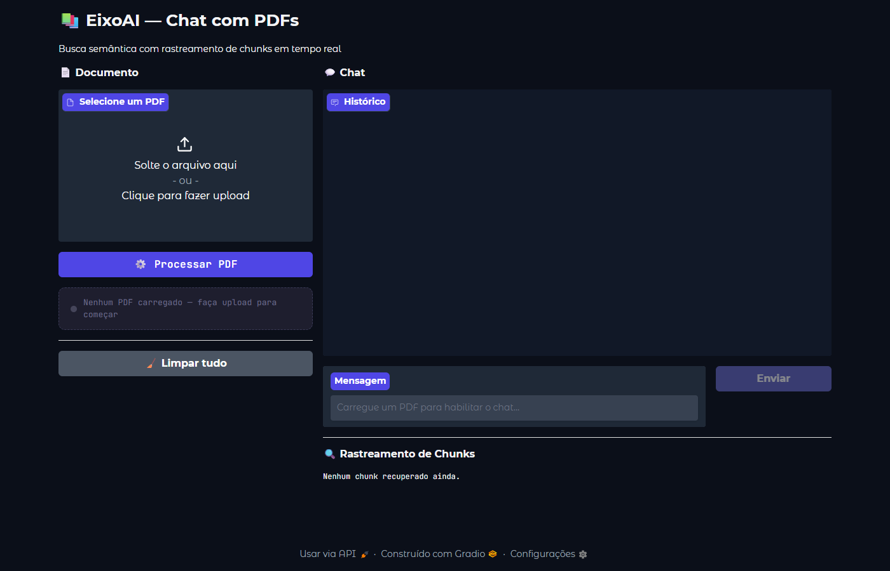
*1. Tela única: um PDF por vez, o botão de processar e o chat.*

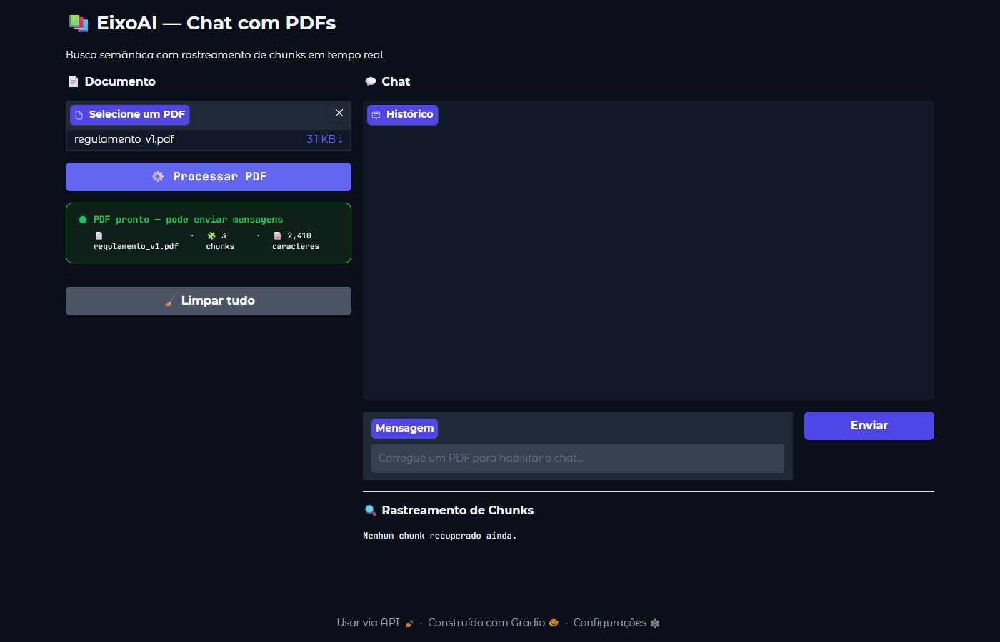
*2. O Regulamento Interno (v1) processado: 3 trechos. Não há nome de documento, autor nem motivo.*

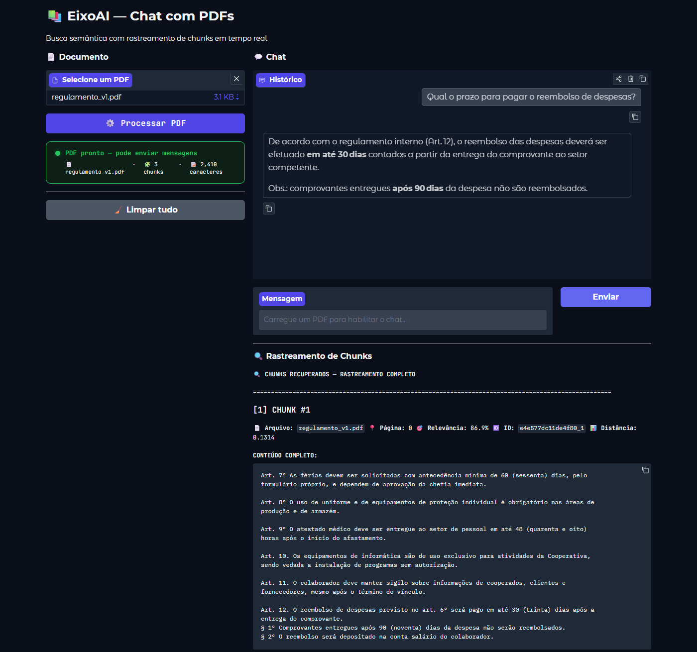
*3. "Qual o prazo para pagar o reembolso de despesas?" A resposta é "até 30 dias" (art. 12). Abaixo, o rastreamento dos trechos, com distância e ID técnicos.*

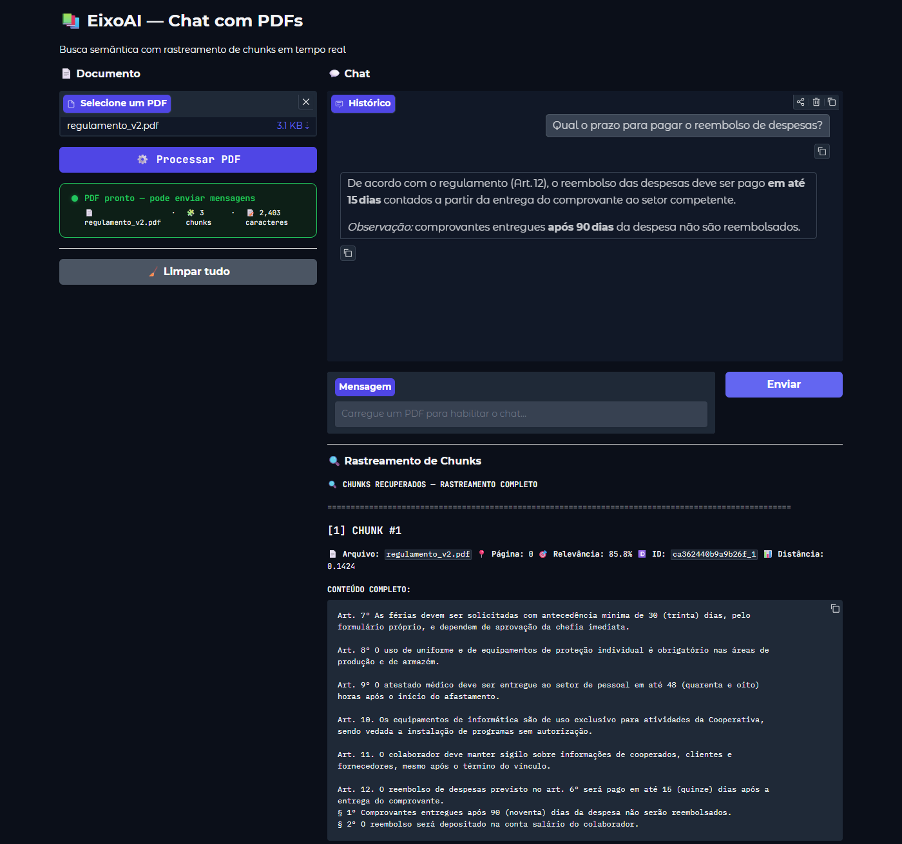
*4. Depois de enviar a v2, a mesma pergunta responde "15 dias". Nada avisa que a regra mudou:*
- *a v1 não fica registrada;*
- *não dá para comparar as versões;*
- *não se sabe quem mudou nem por quê;*
- *ninguém fica sabendo que outros documentos citam o artigo alterado.*

### Depois: a versão da dupla

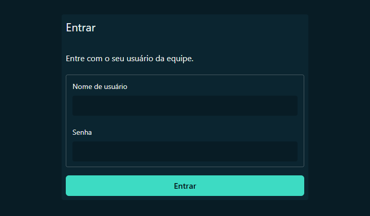
*1. Cada pessoa entra com o próprio usuário. O autor de cada versão e de cada mensagem vem do login.*

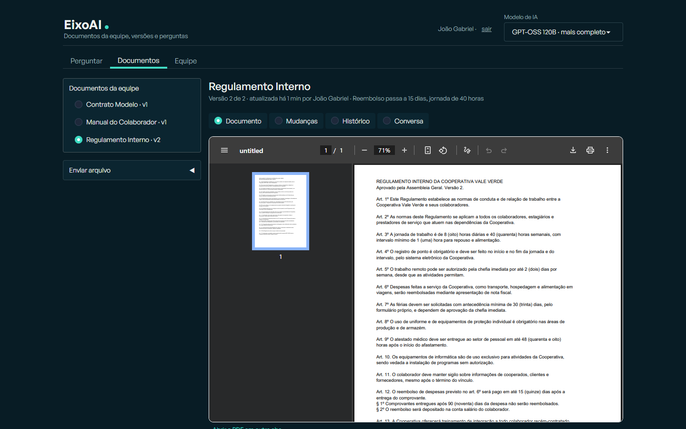
*2. Aba Documentos: a lista de documentos da equipe, com a versão atual, e o próprio PDF na tela. As seções Mudanças, Histórico e Conversa ficam ao lado.*

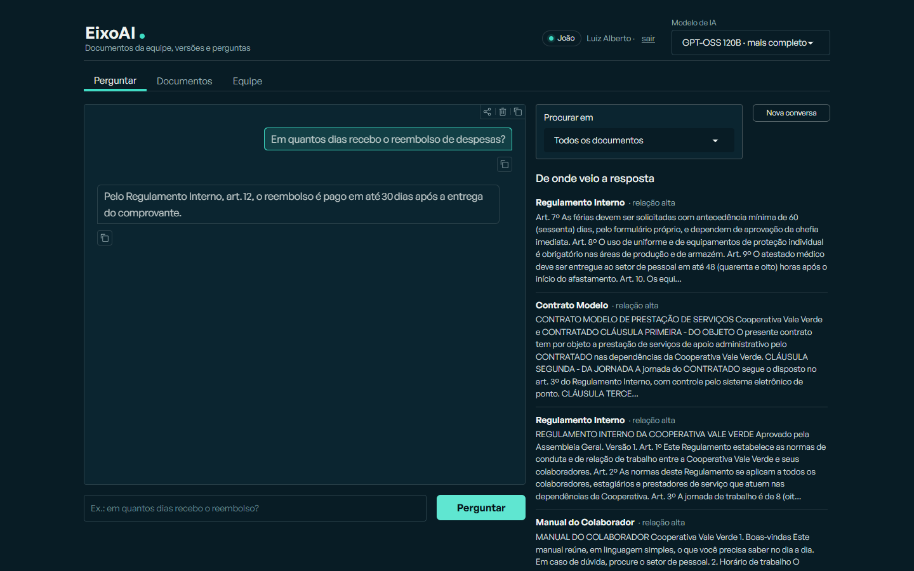
*3. O Luiz pergunta e recebe "30 dias" (art. 12). As fontes mostram o documento e a relação com a pergunta (alta, média, baixa), em vez de distância e ID.*

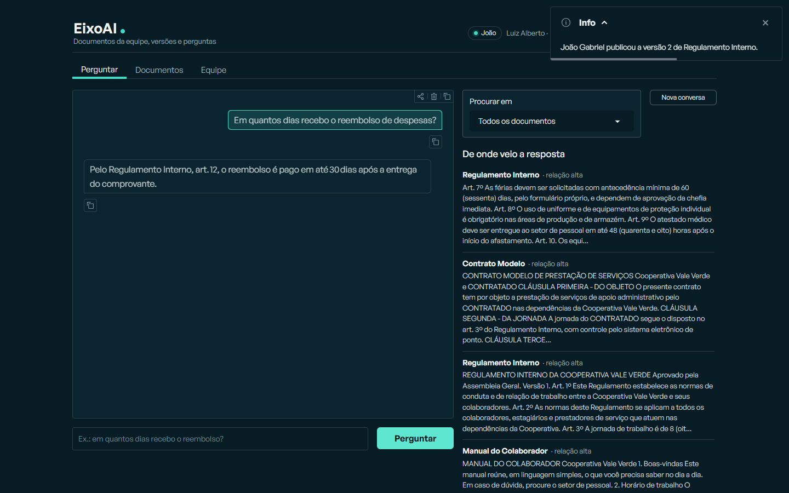
*4. O João publica a v2 do Regulamento. O Luiz, em outro navegador, recebe o aviso na hora: "João Gabriel publicou a versão 2 de Regulamento Interno".*

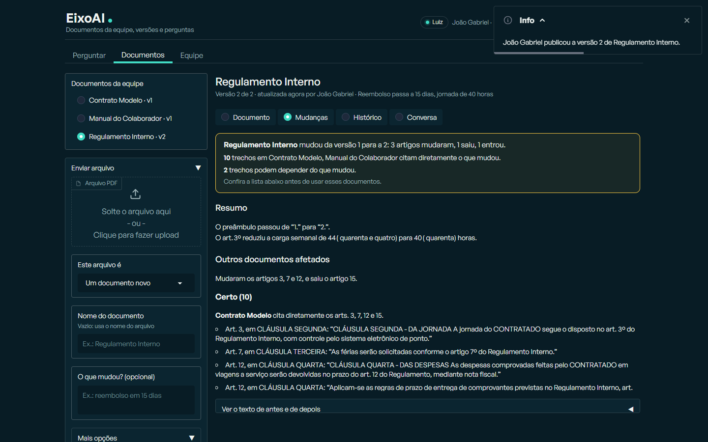
*5. Mudanças. A faixa de aviso diz que 3 artigos mudaram, 1 saiu e 1 entrou. Diz também que 10 trechos do Contrato Modelo e do Manual citam diretamente o que mudou, e que outros 2 podem depender. Abaixo, vêm o resumo feito pela IA e a lista de cada trecho afetado.*

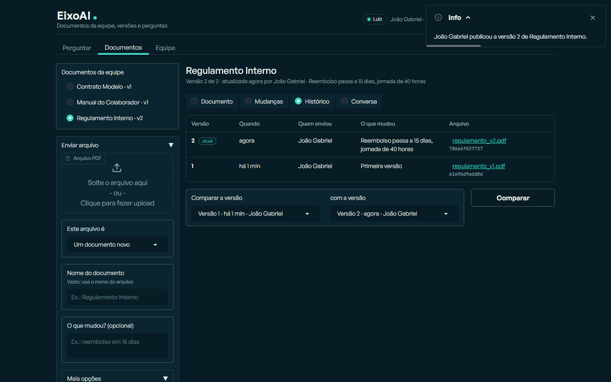
*6. Histórico: quem enviou, quando, o que mudou, o arquivo de cada versão e o código de verificação (SHA-256). Dá para comparar quaisquer duas versões.*

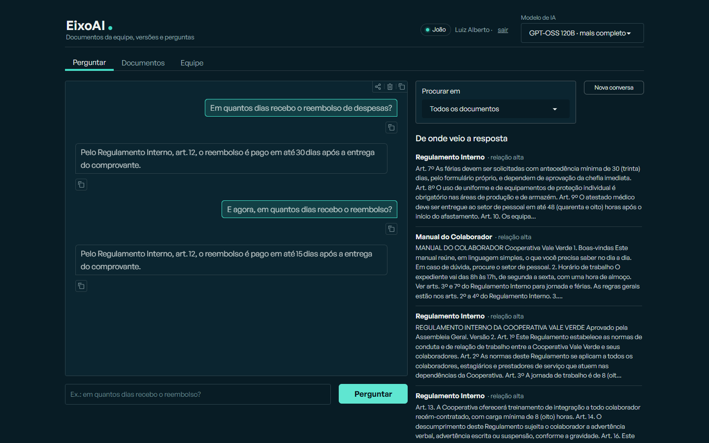
*7. A mesma pergunta, sem recarregar nada, agora responde "15 dias". A busca só considera a versão atual.*

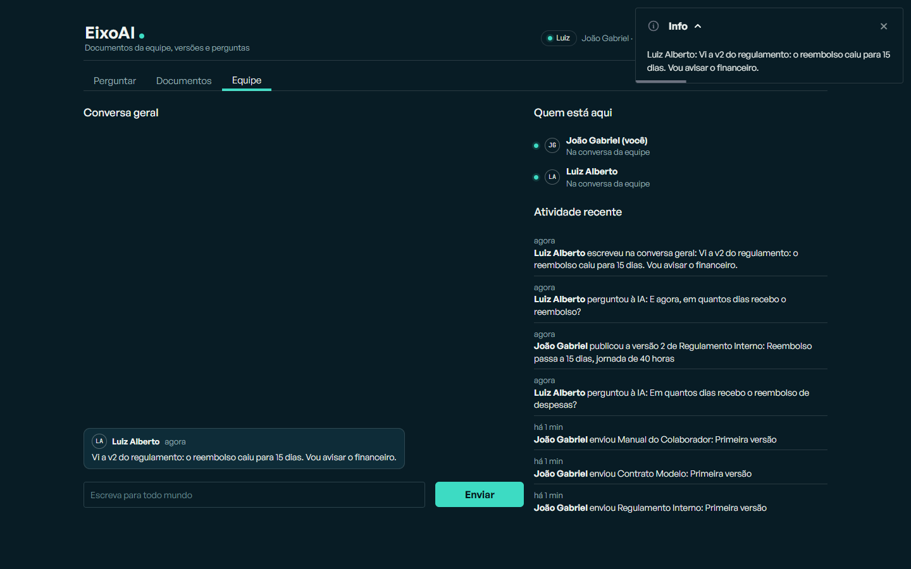
*8. Aba Equipe:*
- *conversa geral;*
- *quem está com o app aberto e o que está vendo;*
- *atividade recente, com versões publicadas, mensagens e perguntas à IA.*

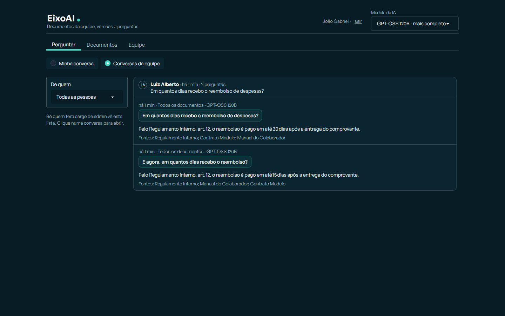
*9. Visão de admin: o que cada pessoa perguntou à IA, com o modelo usado e as fontes da resposta. É a parte de governança mostrada na apresentação.*

## 8. Como rodar e testar

Código: <https://github.com/Jgabriel7z/Atividade-04-andrei>, branch `feature/versionamento-documentos` (a padrão). O `main` é o original do Kaio, sem mudanças.

**Windows, jeito simples:** dois cliques em `iniciar.cmd`, na raiz.
- Na primeira vez, ele cria o ambiente, instala as dependências e cria o `.env` a partir do `.env.exemplo`.
- Preencha no `.env` a `GROQ_API_KEY` e as contas em `EIXOAI_USUARIOS`.
- Nas vezes seguintes, ele abre o navegador e pede só o login.

**À mão (Python 3.12):**

```bash
python -m venv .venv
.venv\Scripts\activate            # Linux/Mac: source .venv/bin/activate
pip install -r requirements.txt
copy .env.exemplo .env            # preencha GROQ_API_KEY e EIXOAI_USUARIOS
cd src
python app.py                     # http://localhost:7860
```

O versionamento e a análise de impacto funcionam sem a chave do Groq. O chat e o resumo da mudança precisam dela.

**Testes** (de dentro de `src/`):

```bash
python test.py --all                 # 8 suítes, 97 verificações (as de LLM precisam da chave)
python test.py --module versioning   # versões, sem chave
python test.py --module impact       # análise de impacto, sem chave
python eval/eval_versoes.py          # critérios 1 a 3 da Atividade 03
python eval/eval_busca.py            # busca com perguntas escritas de 3 formas
python test.py --sample              # critério 4: Hit Rate na CF/88 (EVAL_PDF_PATH no .env)
```

**Documentação no repositório:**
- [`docs/VERSIONAMENTO.md`](VERSIONAMENTO.md): o que foi adicionado, arquivo por arquivo, as decisões e o roteiro de demonstração;
- [`docs/TESTE_EM_DUPLA.md`](TESTE_EM_DUPLA.md): a segunda rodada;
- [`docs/ANTES_E_DEPOIS.md`](ANTES_E_DEPOIS.md): a comparação da primeira rodada.
